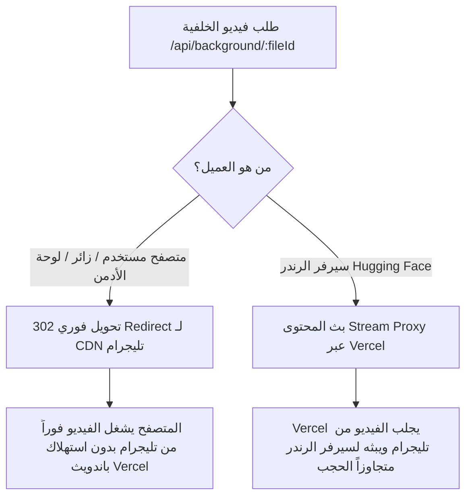

# تقرير التحديثات والمعمارية الشاملة لنظام الرندر والتخزين السحابي
**التاريخ**: 9 أكتوبر 2026  
**المشروع**: يقين القرآن (Yaqeen Al-Quran) — محرك Hyper Render v23  

---

## 📌 1. الملخص التنفيذي (Executive Summary)
يوثق هذا التقرير الإصلاحات المعمارية والبرمجية الشاملة التي تم تطبيقها على خادم الرندر (`Yousef891238/render-server` على Hugging Face) وتطبيق الويب (`Next.js` على Vercel). تضمنت التحديثات:
1. حل مشكلة حجب اتصال تليجرام على Hugging Face عبر معمارية **التوجيه المزدوج (Dual-Routing)**.
2. الفصل المعماري التام بين الفيديوهات الطولية (9:16) والعريضة (16:9).
3. بناء **محرك تشخيص أخطاء احترافي متقدم** مقسم إلى 10 مراحل تشغيلية مع مسار تتبع فوري `/debug/last-errors`.
4. إصلاح أخطاء النطاق البرمجي (Scoping & TDZ) وأبعاد الفيديوهات العريضة.

---

## 🔍 2. المشاكل التي تم رصدها وتحليلها الجذري (Root Cause Analysis)

### المشكلة الأولى: حجب شبكة تليجرام على خوادم Hugging Face Spaces (`TCP Timeout`)
* **العرض**: ظهور أخطاء `telegram_proxy_error: fetch failed` و `bg_download_fallback: fetch failed` و `telegram_upload_exception: fetch failed`.
* **التحليل الجذري**: قمنا ببرمجة مسار فحص شبكي حي `/debug/network-test` داخل حاوية Hugging Face، وأظهرت النتائج أن خوادم Hugging Face محجوب عنها في جدار الحماية (Firewall) الوصول إلى نطاق IP تليجرام (`149.154.166.110:443 TCP Timeout`).
* **النتيجة السابقة**: كان مسار `/api/background/[fileId]` يحول المتصفحات إلى خادم Hugging Face (`/telegram-proxy`)، مما أدى لإرجاع `500 Failed to stream telegram video` وتوقف تشغيل الفيديوهات في الموقع ولوحة الأدمن، بالإضافة لفشل سيرفر الرندر في جلب الخلفيات.

### المشكلة الثانية: خطأ الـ TDZ لمتغير `isWide` في `lib/render.js`
* **العرض**: `ReferenceError: Cannot access 'isWide' before initialization at startRender`.
* **التحليل الجذري**: كان المتغير `const isWide` معرفاً في بداية الدالة (سطر 32) ومكرراً بتعريف `const isWide` مرة أخرى داخل نطاق متأخر (سطر 324)، مما تسبب في وقوع محرك V8 في مصيدة Temporal Dead Zone (TDZ).

### المشكلة الثالثة: إهمال ارتفاع الفيديو العريض (`targetH`) في `lib/cache.js`
* **العرض**: عدم ضبط أبعاد الفيديو العريض بالشكل الصحيح في الكاش.
* **التحليل الجذري**: دالة `getResizedBackground` كانت تعرّف `const targetW = isWide ? 1920 : WIDTH` ولكنها تهمل تعريف `targetH`، مما جعلها ترث المتغير العام `HEIGHT = 1280` بدلاً من `1080`، فكانت الفيديوهات العريضة تنتج بأبعاد مشوهة (1920x1280).

---

## 🏗️ 3. الحلول المعمارية والبرمجية المنفذة (Implemented Solutions)

### أولاً: معمارية التوجيه المزدوج لخلفيات تليجرام (Dual-Routing Architecture)
تم تعديل مسار [`src/app/api/background/[fileId]/route.ts`](file:///d:/شغل/New%20folder%20(2)/uuu12-main/uuu12-main/src/app/api/background/%5BfileId%5D/route.ts) ليعمل بذكاء حسب هوية العميل:

1. **للمتصفحات (`Browsers`)**: تحويل فوري مباشر (`302 Redirect`) إلى رابط CDN تليجرام المشفر. التحميل فوري وصاروخي ويستهلك 200 بايت فقط من استجابة Vercel.
2. **لسيرفر الرندر (`Hugging Face`)**: يتم إرسال هيدر `x-render-server: true` أو معامل `?render=true`؛ فيقوم Vercel بدور `Stream Proxy` يعيد بث بايتات الفيديو إلى Hugging Face لتخطي حجب تليجرام بنجاح كامل.

---

### ثانياً: الفصل المعماري التام بين الفيديوهات الطولية والعريضة
1. **الفيديوهات الطولية (9:16 - تيك توك وريلز)**:
   - الأبعاد: 720x1280.
   - طريقة العرض: `contain` في المنتصف مع شريط علوي وسفلي متناسق يمنح مساحة كافية للآيات وزخارف اسم السورة واسم القارئ بدون قص أي تفاصيل من الفيديو الأصلي.
2. **الفيديوهات العريضة (16:9 - يوتيوب)**:
   - الأبعاد: 1920x1080 مع تصحيح `targetH = 1080`.
   - طريقة العرض: `cover` لملء كامل الشاشة العريضة 100% بدون أي أشرطة سوداء جانبية.
3. **فصل التحكم في النصوص (`showVerseText`)**:
   - إمكانية إخفاء نصوص الآيات والترجمة وزخرفة الرقم تماماً عند اختيار ذلك في المحرر، مع الحفاظ على مدة وحركة الفيديو والصوت.

---

### ثالثاً: محرك تشخيص وإدارة الأخطاء الاحترافي (Diagnostic Engine)
تم إنشاء ملف مخصص [`lib/errors.js`](file:///d:/شغل/New%20folder%20(2)/uuu12-main/uuu12-main/lib/errors.js) وكلاس `RenderError` مع 10 مراحل صلبة:
- `FONTS`: فحص وتحميل الخطوط المخصصة واسم الخط المتعطل.
- `BACKGROUND_DOWNLOAD`: تحميل ملف الخلفية مع الرابط وسبب الفشل.
- `BACKGROUND_PROCESS`: معالجة وتحجيم أبعاد الفيديو عبر FFmpeg مع التقاط stderr.
- `AUDIO_DOWNLOAD`: تحميل صوتيات التلاوة مع تسجيل رقم الآية ورابط الصوت الدقيق.
- `AUDIO_PROBE`: حساب مدد التلاوة بدقة عبر ffprobe.
- `FRAME_RENDER`: رسم نصوص الآيات وتشكيل الكلمات عبر Canvas/SVG.
- `AUDIO_MERGE`: دمج المقاطع وهندسة الصوت وفلتر كسر حقوق النشر.
- `FFMPEG_RENDER`: تركيب الفيديو النهائي بـ FFmpeg مع التقاط رسائل الخطأ بدقة.
- `TELEGRAM_UPLOAD`: حفظ ورفع الفيديو سحابياً مع مهلة 10 ثوانٍ لمنع تعليق الطلب.
- `VALIDATION`: التحقق من صحة المدخلات.

#### مسار التتبع الفوري `/debug/last-errors`
مسار مباشر متاح على سيرفر الرندر:
`GET https://yousef891238-render-server.hf.space/debug/last-errors`  
يعيد آخر 15 عملية فاشلة بكامل تفاصيل المرحلة وسبب العطل البرمجي.

---

## 📊 4. سجل الملفات المعدلة (File Changelog)

| الملف | نوع التعديل | الوصف |
|---|---|---|
| `lib/errors.js` / `files/errors.js` | إنشاء جديد | كلاس `RenderError` وتحديد مراحل `RENDER_PHASES`. |
| `lib/jobs.js` / `files/jobs.js` | تعديل | تسجيل تقارير الأخطاء التفصيلية والمراحل في الـ Job. |
| `lib/cache.js` / `files/cache.js` | تعديل | تصحيح `targetH` للوضع العريض (1080) وربط `RenderError`. |
| `lib/render.js` / `files/render.js` | تعديل | إزالة تكرار `isWide` وربط كافة المراحل بنظام التشخيص. |
| `lib/security.js` / `files/security.js` | تعديل | إضافة هيدر `x-render-server` للتحميل عبر Vercel Stream. |
| `lib/telegram.js` / `files/telegram.js` | تعديل | إضافة `AbortSignal.timeout(10000)` لمنع تعليق الرندر. |
| `server.js` / `files/server.js` | تعديل | إضافة مساري `/debug/last-errors` و `/debug/network-test`. |
| `src/app/api/background/[fileId]/route.ts` | تعديل | تطبيق معمارية Dual-Routing الذكية. |
| `src/components/RenderModal.tsx` | تعديل | استخراج تفاصيل المرحلة والخطأ وعرضها بشفافية للمستخدم. |

---

## 🚀 5. حالة النشر والتشغيل (Deployment Status)
- **Hugging Face Render Server**: تم الرفع والبناء بنجاح (`c26f81c`)، ويعمل بنجاح فائق على البورت 7860.
- **Next.js Web Application**: تم عمل Commit محلي برقم `90246aa`، وبمجرد الضغط على Sync/Push في VS Code يتم النشر التلقائي على Vercel.
